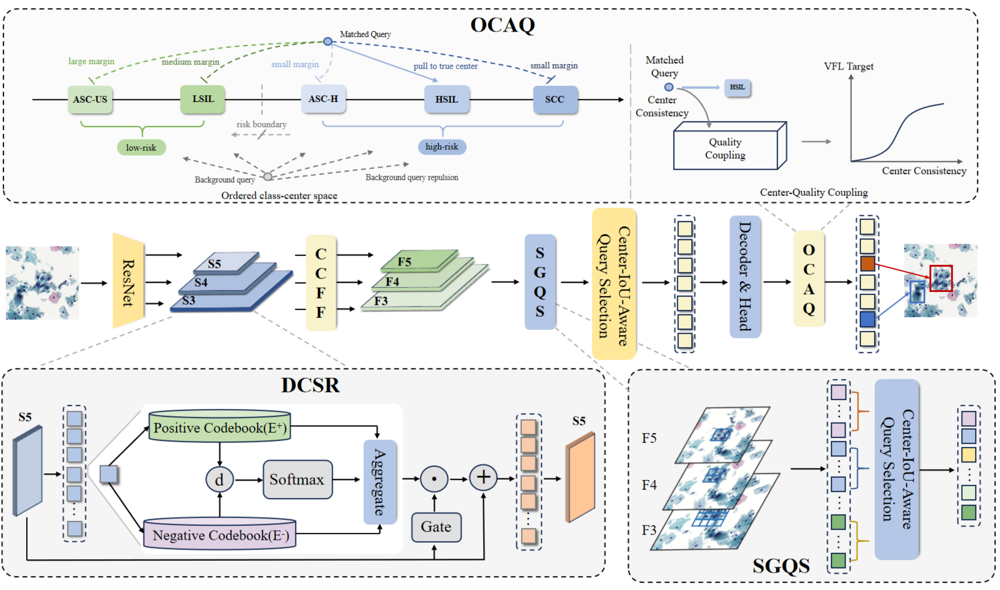

# CytoSet

**CytoSet: Bethesda-Order-Aware Set Prediction for Cervical Cytology Cell Detection**

CytoSet detects abnormal squamous cells in ThinPrep Cytologic Test (TCT) images and learns their Bethesda category order. It combines query-set conditioning with ordered representation learning to improve detection and reduce severe category errors after localization.

## Why Bethesda order matters

Accurately locating a cell does not guarantee a consistent Bethesda category assignment. Adjacent categories can look similar, while an error spanning several reporting boundaries, or downgrading a high-grade cell, can remove important cellular evidence from downstream review.

CytoSet uses the operational reporting order **ASC-US → LSIL → ASC-H → HSIL → SCC**. Rank distance counts crossed reporting boundaries, rather than equal biological progression or patient-risk intervals. The central idea is to build a semantically reliable, spatially diverse query set before applying Bethesda-order-aware supervision.

## Method



The method follows two stages: DCSR and SGQS condition the query set before decoding; OCAQ then learns ordered representations from matched decoder queries.

### 1. Dual-Codebook Semantic Refinement (DCSR)

Abnormal-cell features can be mixed with non-object cytological responses. DCSR refines the projected high-level S5 feature map using jointly assigned positive and negative codebooks. Weak region supervision encourages abnormal-cell-related and non-object roles, while gated reconstruction refines the features before cross-scale fusion.

### 2. Spatial-Grouped Query Selector (SGQS)

High-scoring proposals from different scales can concentrate on the same local evidence. SGQS groups candidates by their coarse S5 spatial support, retains one representative per group, and applies global top-K selection to those representatives. This promotes spatial diversity in the initial decoder query set.

### 3. Ordered Center Alignment and Quality Coupling (OCAQ)

Matched queries are aligned with shared Bethesda class centers in a normalized representation space. Ordered alignment and asymmetric downgrade supervision distinguish the extent and direction of category errors. Center consistency is also coupled with predicted-box IoU to supervise classification quality. Each supervised proposal or decoder output computes its own quality target using a shared center bank.

## Results

### Cell-level detection and Bethesda consistency

TCT-MS contains 28,044 patches and 31,402 annotated cells from 445 WSIs acquired with two scanners. The benchmark uses patient-level splits. Results are mean ± standard deviation over three random seeds (42, 2026 and 3407).

| Metric | RT-DETR | RT-DETR + Rank-VFL | CytoSet |
| --- | --- | --- | --- |
| mAP@[0.5:0.95] ↑ | 37.16 ± 0.36 | 37.43 ± 0.39 | **39.08 ± 0.31** |
| AP@0.5 ↑ | 51.18 ± 0.40 | 51.55 ± 0.43 | **53.72 ± 0.36** |
| AP@0.75 ↑ | 41.58 ± 0.47 | 41.82 ± 0.50 | **43.52 ± 0.35** |
| Localization-controlled accuracy ↑ | 74.39 ± 0.44 | 75.02 ± 0.48 | **76.62 ± 0.42** |
| Severe cross-grade error rate ↓ | 7.01 ± 0.29 | 6.69 ± 0.31 | **5.78 ± 0.24** |
| Mean ordinal error ↓ | 0.360 ± 0.008 | 0.349 ± 0.009 | **0.316 ± 0.009** |
| High-risk recall ↑ | 88.62 ± 0.82 | 88.95 ± 0.79 | **89.86 ± 0.64** |
| High-risk downgrading rate ↓ | 10.37 ± 0.72 | 9.61 ± 0.68 | **7.82 ± 0.46** |

All values except mean ordinal error are percentages. Grade-consistency metrics use class-agnostic one-to-one matches at IoU ≥ 0.5. Severe cross-grade errors cross at least two category boundaries. High-risk downgrading is measured among localized high-risk cells; high-risk recall includes missed high-risk cells in its denominator. In this task, ASC-H, HSIL and SCC form the high-risk group.

Compared with RT-DETR, CytoSet improves mAP by **1.92 percentage points** while reducing both severe cross-grade errors and high-risk downgrading. Rank-VFL provides an output-level rank-weighting comparison without query-space centers or quality coupling.

<details>
<summary>Component ablations on TCT-MS</summary>

| DCSR | SGQS | OCAQ | mAP ↑ | Severe cross-grade error ↓ | High-risk downgrading ↓ |
| --- | --- | --- | --- | --- | --- |
| — | — | — | 37.16 ± 0.36 | 7.01 ± 0.29 | 10.37 ± 0.72 |
| ✓ | — | — | 38.08 ± 0.44 | 6.92 ± 0.34 | 10.18 ± 0.78 |
| — | ✓ | — | 37.82 ± 0.46 | 7.06 ± 0.36 | 10.44 ± 0.82 |
| — | — | ✓ | 37.68 ± 0.42 | 6.42 ± 0.30 | 8.94 ± 0.64 |
| ✓ | ✓ | — | 38.88 ± 0.39 | 6.86 ± 0.33 | 10.02 ± 0.75 |
| ✓ | — | ✓ | 38.50 ± 0.38 | 5.96 ± 0.26 | 8.22 ± 0.56 |
| — | ✓ | ✓ | 38.34 ± 0.43 | 6.18 ± 0.31 | 8.67 ± 0.62 |
| ✓ | ✓ | ✓ | **39.08 ± 0.31** | **5.78 ± 0.24** | **7.82 ± 0.46** |

Values are percentages, reported as mean ± standard deviation over three seeds. OCAQ provides the largest standalone improvements in the two grade-consistency metrics shown here. SGQS improves detection but does not provide a standalone gain in these grade-consistency metrics.

</details>

### External transfer

For **TCT-MS → Tianchi** transfer, the paper reports an mAP increase from **15.9 ± 0.60 to 17.0 ± 0.52**, with severe cross-grade error decreasing from **27.42 ± 0.50% to 23.78 ± 0.43%**. This setting evaluates transfer between datasets, separately from training and testing within the same dataset.

### Exploratory WSI evidence retention

The paper also evaluates whether detector-derived cell evidence retains high-grade categories when aggregated at slide level.

| Positive-WSI cohort | RT-DETR WSI high-risk downgrading | CytoSet WSI high-risk downgrading |
| --- | --- | --- |
| Internal, 414 WSIs | 20.3% (28/138) | **14.5% (20/138)** |
| Tianchi, 500 WSIs | 28.5% (80/281) | **22.8% (64/281)** |

The denominators are the high-risk reference WSIs in each cohort. These results concern exploratory detector-derived evidence retention, not a validated patient-level diagnosis or screening endpoint.

## Installation

Use Python 3.10 with the PyTorch and torchvision versions specified in the requirements:

```bash
pip install -r requirements.txt
```

## Data preparation

Public datasets are available from the [Tianchi competition](https://tianchi.aliyun.com/competition/entrance/231757/introduction) and the [CRIC Cervix database](https://database.cric.com.br/).

Prepare 640 × 640 patches with COCO-format annotations and set the paths in `configs/dataset/tct_5class.yml`. The category mapping is:

| Category ID | Category | Ordinal rank |
| --- | --- | --- |
| 0 | ASC-US | 0 |
| 1 | ASC-H | 2 |
| 2 | LSIL | 1 |
| 3 | HSIL | 3 |
| 4 | SCC | 4 |

See [configuration and usage](REPRODUCTION.md) for the expected patch and annotation layout.

## Training

```bash
python tools/train.py -c configs/rtdetr/rtdetr_cytoset_seed42.yml --seed 42
```

To run the three provided seeds:

```bash
bash run_cytoset_seeds.sh
```

## Evaluation

```bash
python tools/train.py -c configs/rtdetr/rtdetr_cytoset_seed42.yml -r path/to/checkpoint.pth --test-only
```

The instructions use single-GPU FP32 execution. See [configuration and usage](REPRODUCTION.md) for dataset layout, model settings and checkpoint options, and [tools](tools/README.md) for command-line utilities.

## License

Third-party attribution and license texts are provided in [THIRD_PARTY_NOTICES.md](THIRD_PARTY_NOTICES.md). A license for new CytoSet contributions has not yet been specified.
